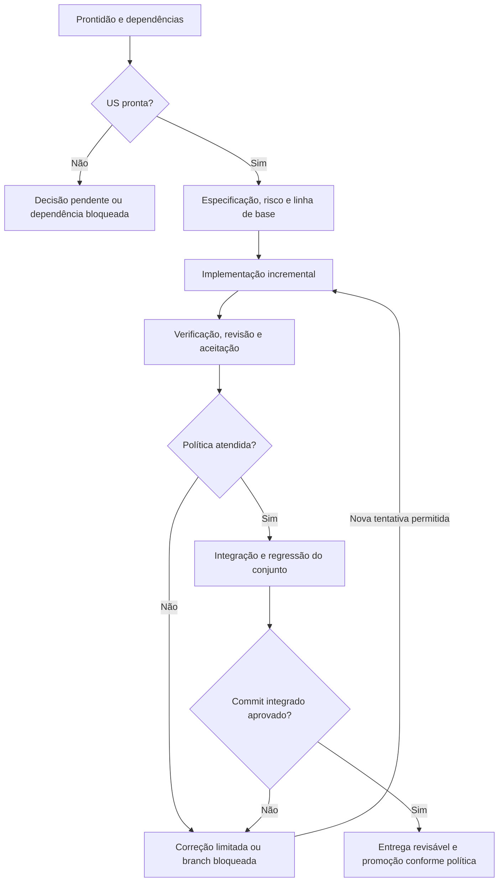

# FazTudo — Plano de evolução do pipeline e da plataforma

Versão 1.0 · 26 de novembro de 2026

## 1. Decisão proposta

Evoluir o FazTudo para conduzir alterações de software com critérios de aprovação verificáveis, execução adaptada ao risco e desempenho medido. Preservar Go, a distribuição local, o dashboard embutido e os adaptadores de CLI existentes. Implementar em seis incrementos, com mudanças pequenas, compatíveis e testadas.

Este documento é um plano de implementação. Nenhuma alteração de código, branch, issue ou PR foi realizada para produzi-lo. A análise é estática; não houve execução da aplicação, testes ou benchmark.

Base conferida: branch `main`, commit `2af041c50e74ebe327079637a60088644198f6d7`. Outras branches precisam ser comparadas com essa base antes da implementação para reaproveitar trabalho existente.

### Objetivos

1. **Robustez:** uma entrega só é aprovada com evidência válida; falhas bloqueantes não são promovidas.
2. **Flexibilidade:** políticas por projeto e risco selecionam verificações e especialidades necessárias.
3. **Eficiência da execução:** menos chamadas desnecessárias, contexto atualizado, paralelismo limitado e recuperação segura.
4. **Desempenho do software entregue:** requisitos e benchmarks verificam latência, consumo de recursos e escalabilidade quando relevantes.
5. **Revisão simples:** cada decisão fica vinculada à US, ao commit, à configuração e aos resultados executados.

## 2. Ponto de partida e lacunas verificadas

O projeto já tem discovery, Passo 0, especificação, arquitetura, implementadores, verificações determinísticas, revisão, segurança, E2E, documentação, worktrees, recuperação, registro de tokens, skills incorporadas e benchmark. Essas capacidades devem ser aproveitadas.

| Evidência no código | Consequência | Tratamento planejado |
|---|---|---|
| `enforceGate` considera aprovada a ausência de veredito JSON legível | Uma resposta inutilizável pode liberar o fluxo | FT-001 |
| `parseVerdict` aceita status não vazio; `NeedsChanges` depende de um valor específico e de issues | Saídas inconsistentes podem não bloquear | FT-001 |
| `closeStory` admite pendências e `finishSucceeded` ainda conclui como sucesso | Conclusão técnica se mistura com aprovação | FT-002 |
| Integração da onda promove branches sem portão executável obrigatório sobre o conjunto resultante | Mudanças que passam isoladas podem falhar combinadas | FT-003 |
| Cache de discovery não possui validação por alterações relevantes | Contexto arquitetural pode ficar desatualizado | FT-006 |
| `TraceTests` encontra referências aos IDs dos requisitos em arquivos | Referência não comprova que o caso executou e passou | FT-012 |
| `score` retorna proporção 1 quando não há observações | Ausência de testes pode aumentar a nota | FT-026, com correção inicial no incremento 1 |
| Workflow presente é de release por tag ou acionamento manual | Verificação contínua de PR não está definida nesse workflow | FT-004 |

Não são conclusões sobre incidentes em produção. São regras e caminhos identificados na base consultada.

## 3. Princípios de implementação

- O modelo propõe planos, hipóteses e análises. O código do orquestrador valida contratos, executa comandos e decide se a política foi atendida.
- Um parecer de LLM não substitui resultado de teste, benchmark ou scanner.
- Não avaliado, omitido, inconclusivo, simulado e aprovado são situações diferentes.
- O arquiteto pode acrescentar verificações; não pode retirar o mínimo obrigatório da política.
- Comandos executáveis vêm de configuração validada ou adaptadores fixos. Texto gerado por modelo não vira comando de shell.
- Um agente adicional é uma responsabilidade especializada, acionada quando necessária. Não implica mais um processo permanente nem uma chamada obrigatória em toda US.
- Retomadas só reutilizam evidências compatíveis com o código e os insumos atuais.
- Toda mudança de comportamento do FazTudo recebe teste no pacote, seguindo a constituição do repositório.
- Alterações de prompts, skills, modelos e políticas são versionadas e avaliadas.
- Não presumir isolamento equivalente entre CLIs: reconhecer capacidades e limitações de cada adaptador.

## 4. Pipeline de destino

| Ordem | Etapa | Execução | Saída exigida |
|---:|---|---|---|
| 0 | Preflight do ambiente | Determinística | Repositório, estado Git, ferramentas, capacidades do provedor e comandos disponíveis |
| 1 | Discovery incremental | Scanner + modelo quando necessário | Contexto com origem, validade, arquitetura, convenções e comandos |
| 2 | Prontidão e Passo 0 | Agente de requisitos/contexto | Critérios claros, dependências e decisão `reuse`, `extend`, `refactor`, `implement` ou `block` |
| 3 | Especificação e aceitação | Agente de especificação | Contratos, cenários, requisitos não funcionais e métodos de comprovação |
| 4 | Arquitetura, impacto e risco | Arquiteto + política | Plano, dependências, verificações obrigatórias, especialidades e escopo |
| 5 | Linha de base | Runner determinístico | Resultados anteriores à alteração e caracterização de falhas preexistentes |
| 6 | Implementação incremental | Implementadores + runner | Pequenas mudanças, testes relevantes e evidências de cada ciclo |
| 7 | Verificação e revisão | Runner + revisores em leitura | Resultados executáveis, contratos, segurança e qualidade |
| 8 | Aceitação funcional | QA funcional + runner | Critérios atendidos por cenários executados ou forma de comprovação definida |
| 9 | Integração e regressão | Git + runner; agente apenas em conflitos | Conjunto integrado verificado, sem promoção antecipada |
| 10 | Preparação e decisão de entrega | Montagem determinística + documentação necessária | Diff, evidências, pendências, documentação e branch ou PR revisável |

Discovery vale por projeto; prontidão e critérios valem por US. Integração vale por onda/conjunto candidato. Verificações rápidas ocorrem durante a implementação e não apenas ao fim.

### Caminhos principais

Documentação que altera o repositório deve entrar antes da verificação final do commit candidato. Mudanças posteriores ao resultado de um teste invalidam as evidências afetadas. No primeiro incremento, qualquer alteração posterior invalida conservadoramente a aprovação final.

## 5. Agentes e responsabilidades

| Papel | Situação | Ativação | Permissão e limite |
|---|---|---|---|
| Context Scout / Analista de requisitos | Ampliar o Passo 0 | Toda US; profundidade proporcional ao risco | Leitura; não modifica a US original nem inventa decisões de negócio |
| Spec Engineer | Existente, ampliado | Desenvolvimento que exige especificação | Leitura; produz artefato estruturado persistido pelo orquestrador |
| Arquiteto / Analista de impacto | Existente, ampliado | Planejamento | Leitura; considera contratos e consumidores, além de arquivos |
| Frontend / Backend | Existentes | Frentes selecionadas | Escrita no workspace isolado e comandos permitidos |
| QA de testes | Novo papel | Lacunas de cobertura, bugs e cenários complexos | Escreve testes em fase/worktree própria; não altera os critérios para obter aprovação |
| QA funcional | Novo papel | Jornadas e regras de negócio | Analisa evidências e usa runner controlado; revisão da implementação em leitura |
| Especialista de UX | Condicional | Jornada visual nova ou ambígua | Protótipo em área definida antes da implementação; validação com evidências visuais |
| Especialista de dados/migrations | Condicional | Alteração de schema, transformação ou compatibilidade | Planejamento em leitura; implementação isolada; validação de dados pelo runner |
| Segurança / modelagem de ameaças | Existente, ampliado | Política obriga para mudanças sensíveis | Leitura; ferramentas de análise executadas pelo runner |
| Especialista de desempenho | Novo papel condicional | SLO, consultas, concorrência, processamento e caminhos críticos | Hipóteses baseadas em profiling; alterações isoladas; benchmark decide o resultado |
| Revisores de código | Existentes | Conforme política e risco | Leitura; revisão final considera o código resultante das correções |
| Investigador de falhas | Existente, reutilizado | Falha reproduzível que exige diagnóstico | Sem edição; dossiê de causa raiz e evidência |
| Integrador | Existente, reforçado | Conflitos reais entre alterações | Escrita apenas na branch candidata; nunca promove código por conta própria |
| Documentação | Existente | Quando mudança pede guia, contrato ou ADR | Escrita nos caminhos definidos; roda antes da validação final |

QA de testes e implementadores não escrevem simultaneamente os mesmos arquivos. Worktrees distintas não eliminam dependências semânticas; o scheduler deve considerar contratos, migrations, serviços e recursos compartilhados.

## 6. Políticas, estados e contratos

### 6.1 Três dimensões separadas

| Dimensão | Exemplos de estado | Significado |
|---|---|---|
| Execução | `queued`, `running`, `waiting_input`, `completed`, `failed`, `canceled` | O processo iniciou, terminou ou precisa de decisão |
| Validação | `pending`, `passed`, `failed`, `inconclusive`, `not_evaluated`, `not_applicable` | A evidência permite aceitar a alteração? |
| Integração | `not_started`, `candidate`, `verified`, `awaiting_review`, `integrated`, `blocked`, `partial` | O que ocorreu com a branch e a base? |

`simulated` é uma propriedade da execução/evidência; simulação nunca habilita promoção real. Etapa opcional omitida conserva justificativa. Etapa obrigatória não executada bloqueia a aprovação. `not_applicable` exige justificativa aceita pela política, não apenas declaração do agente.

### 6.2 Regra de promoção

Promover exige: contrato válido, todas as verificações obrigatórias aprovadas, nenhuma pendência bloqueante, dependências disponíveis no snapshot usado, commit e configuração correspondentes às evidências, e política de revisão satisfeita. A base não pode ter mudado desde a validação sem revalidação.

Achados críticos/altos e falhas funcionais bloqueiam por padrão. Achados de menor severidade podem ser informativos conforme política explícita. Severidade desconhecida não é rebaixada silenciosamente. Exceções permitidas pela organização precisam de justificativa, responsável, escopo e validade; o LLM não aprova a própria exceção.

### 6.3 Saídas estruturadas

Contratos versionados para prontidão, especificação, plano, parecer, aceitação e evidência. Validar enumerações, campos obrigatórios, referências e consistência. Exemplo: `approved` com achado bloqueante é inconsistente. Status desconhecido, `changes_requested` sem descrição útil e referências inexistentes são inválidos.

Onde o CLI suportar saída estruturada, usar o recurso. Nos demais, parser estrito e normalização controlada. Permitir até duas tentativas limitadas de recuperação do formato, sem reimplementar código. Persistindo, marcar inconclusivo e bloquear promoção. Cancelamento, quota e indisponibilidade são classificados separadamente.

### 6.4 Risco e composição do fluxo

O usuário escolhe um perfil de execução; a política calcula as exigências efetivas. Preferências de velocidade não desligam exigências mínimas.

| Mudança | Exigências típicas |
|---|---|
| Texto/documentação | Formatação, links e build quando afetado |
| Componente visual | Build, testes relacionados e avaliação visual/a11y quando aplicável |
| Regra de negócio/API | Unitários, integração, contratos e cenários negativos |
| Autenticação/permissões | Segurança obrigatória e testes negativos de autorização |
| Persistência/migration | Integridade, compatibilidade, execução em dados descartáveis e reversão ou estratégia de recuperação |
| Caminho crítico de desempenho | Workload representativo, profiling e orçamento/SLO verificável |
| Infraestrutura/execução de agentes | Testes de capacidades, isolamento, retomada e gerenciamento de processos |

Modelo sugere risco; regras determinísticas e configuração do projeto impõem o mínimo e podem elevar a classificação pelo diff real. Risco indeterminado usa perfil conservador. Após uma correção ampliar o escopo, recalcular as exigências.

## 7. Arquitetura de implementação

Manter um monólito modular em Go. Extrair responsabilidades gradualmente, com testes de comportamento, sem uma reescrita inicial ou um motor genérico de workflows.

| Área | Base existente | Evolução proposta |
|---|---|---|
| Contratos e decisões | `pipeline/plan.go`, `orchestrator.go` | Contratos versionados, estados e decisão pura de aprovação |
| Política | `workspace/policy.go` | Exigências por risco, regras de promoção e configuração compatível |
| Contexto | `workspace/workspace.go`, `scan.go`, `graph.go` | Fingerprints e atualização incremental com fallback completo |
| Execução | `pipeline/sequence.go`, `streams.go`, `candidates.go` | Scheduler com dependências, recursos e limites |
| Verificação | `pipeline/verifier.go`, `quality/*` | Linha de base, runners estruturados, evidências e regressão integrada |
| Provedores | `provider/cli.go`, `router.go` | Matriz de capacidades, preflight e failover compatível |
| Persistência | `pipeline/journal.go`, `settings/*` | Manifestos versionados, compatibilidade e retomada invalidando evidências obsoletas |
| Avaliação | `eval/eval.go` | Resultados sem pontuação artificial, repetições e métricas de qualidade/custo |
| Produto | `server/*`, `console*`, `web/static/*` | APIs compatíveis e visualização dos estados e decisões |
| Git e revisão externa | `vcs/git.go` | Candidato verificado, proteção contra base alterada e interface para provedores SCM |

Novos arquivos podem começar nos pacotes existentes, por exemplo `contracts.go`, `acceptance.go`, `baseline.go`, `promotion.go`, `scheduler.go` e `evidence.go`. Criar novos pacotes só quando os limites de responsabilidade estiverem claros.

### Modelo mínimo de dados

| Entidade | Conteúdo |
|---|---|
| `RunManifest` | Versão do schema, US/insumos por hash, repositórios e SHAs, política, prompts, skills, modelos, versões dos CLIs e identidade do ambiente sem segredos |
| `ReadinessReport` | Critérios claros/ambíguos, decisões pendentes, dependências, decisão e referências |
| `RiskAssessment` | Classe, motivos, regras acionadas e verificações obrigatórias |
| `BaselineReport` | Snapshot, comandos, resultados, falhas conhecidas e condições do ambiente |
| `VerificationResult` | Check configurado, resultado, versão do runner, duração, commit e artefatos |
| `TestCaseExecution` | Critério, caso, suite, status, runner e evidência; desconhecido permanece desconhecido |
| `AcceptanceReport` | Critérios e métodos de comprovação, resultados e limitações |
| `IntegrationCandidate` | Branches/fontes, conjunto efetivamente integrado, SHAs, regressão e alvo de promoção |
| `DeliveryReport` | Diff, evidências, decisões, pendências, documentação e URL de PR quando existir |
| `BudgetUsage` | Limites, consumo observado, consumo estimado identificado e motivo de interrupção |

Identificadores de evidência são estáveis. A evidência pertence a um snapshot do código e não é automaticamente herdada por commits posteriores. Logs e artefatos recebem redação de segredos e permissões locais restritas; configuração de retenção evita crescimento ilimitado. Hash identifica conteúdo, sem prometer reprodutibilidade bit a bit de uma chamada LLM.

### Compatibilidade e API

Versionar configurações e journals; realizar leitura compatível e migração com cópia recuperável. Não converter um `succeeded` antigo em aprovação comprovada. Uma retomada antiga sem informações suficientes exige revalidação antes da promoção.

Preservar endpoints existentes. Adicionar campos de estado de forma compatível e operações de consulta de evidências, resposta a decisões pendentes e preparação da entrega. Os nomes e schemas finais ficam na spec de cada incremento. Escritas continuam protegidas pelas restrições de origem e acesso local existentes.

## 8. Seis incrementos de implementação

| Incremento | Objetivo | Itens | Dependências | Critério de saída |
|---|---|---|---|---|
| 1 | Aprovação e integração seguras | FT-001 a FT-005; correção mínima de FT-026 | Base atual | Nenhum caminho conhecido promove saída inválida, falha bloqueante ou conjunto não verificado |
| 2 | Contexto e planejamento confiáveis | FT-006 a FT-010 | 1 | Prontidão, risco, dependências e linha de base registrados |
| 3 | Implementação e aceitação comprováveis | FT-011 a FT-016 | 1 e 2 | Critérios vinculados a evidência; especialistas acionados corretamente |
| 4 | Retomada, integração e entrega revisáveis | FT-017 a FT-020 | 1 a 3 | Retomada segura, dependências corretas e entrega por branch/PR com evidências |
| 5 | Eficiência e desempenho | FT-021 a FT-025 | Medição desde 1; consolidação após 2 e 3 | Orçamento, concorrência, contexto e desempenho observáveis e controlados |
| 6 | Validação e adoção | FT-026 a FT-030 | Suite cresce desde 1; piloto final após 4 e 5 | Piloto compara configurações e demonstra qualidade sem esconder ausência de evidência |

Instrumentação, correção da nota do benchmark e testes de segurança de aprovação começam no incremento 1. Não adiar esses fundamentos para o fim. Cada incremento deve poder ser entregue e usado antes do próximo.

## 9. Backlog de implementação

Os IDs FT identificam o plano. Na implementação, converter em specs/US do padrão do repositório. Os critérios abaixo são verificáveis; o tamanho real de cada item será refinado na spec.

### Incremento 1 — Aprovação e integração

#### FT-001: Validar contratos de saída e pareceres

Como responsável pelo projeto, quero que respostas inválidas ou inconsistentes não aprovem uma alteração.

Critérios de aceitação:
- Schemas/validadores versionados rejeitam status desconhecido e combinações inconsistentes.
- Resposta sem JSON válido não aprova e não é confundida com simulação.
- Recuperação de formato tem limite e termina como inconclusiva quando não resolve.
- Testes cobrem saída vazia, truncada, inválida, contraditória e válida.

#### FT-002: Separar conclusão, validação e integração

Como usuário, quero identificar se a execução terminou, se a entrega foi aprovada e se entrou na base.

Critérios de aceitação:
- As três dimensões ficam persistidas e aparecem na API/CLI/UI.
- Pendências bloqueantes impedem aprovação mesmo com execução concluída.
- O resumo distingue resultados simulados, omitidos, inconclusivos e aprovados.
- Leitura de registros antigos não inventa evidência de aprovação.

#### FT-003: Proteger promoção e verificar o conjunto integrado

Como mantenedor, quero que a base receba somente um candidato aprovado no seu estado final.

Critérios de aceitação:
- Um avaliador determinístico central governa todas as rotas de promoção, inclusive sequencial, paralela, correção e retomada.
- Branch com pendência bloqueante é preservada e excluída do candidato promovível.
- Toda onda/candidato recebe verificações obrigatórias após os merges, com ou sem conflito textual.
- Base alterada ou novo diff após a validação exige revalidação.
- Teste integra duas US que passam isoladas e falham juntas; a base permanece intacta.

#### FT-004: Executar CI de desenvolvimento

Como mantenedor, quero validar alterações do próprio FazTudo antes da release.

Critérios de aceitação:
- Workflow de PR roda `make lint`, `make test` e build compatível com a plataforma testada.
- Runner determinístico usa CLIs falsos/fixtures nos testes; não depende de quota LLM real.
- Testes de segurança de aprovação, integração e retomada entram na suíte normal.
- Release reutiliza verificações aprovadas ou executa validação equivalente; checks necessários e instruções de proteção da branch ficam documentados.

#### FT-005: Formalizar capacidades e preflight dos provedores

Como usuário, quero saber se o CLI disponível consegue executar a política solicitada.

Critérios de aceitação:
- Registrar versão e capacidades de leitura, escrita, comandos, saída estruturada, isolamento, tokens e cancelamento.
- Falha de capacidade obrigatória impede início da tarefa dependente e informa o motivo.
- Failover preserva as exigências de permissões; não troca silenciosamente por provedor menos restritivo.
- Testes de adaptadores validam argumentos, parsing, quota, cancelamento e processo filho.
- Não prometer allowlist de comandos para um adaptador que não a implementa; usar isolamento externo quando necessário ou recusar esse modo.

### Incremento 2 — Contexto, prontidão e risco

#### FT-006: Atualizar discovery incrementalmente

Como agente executor, quero contexto coerente com a versão do projeto.

Critérios de aceitação:
- Registrar SHA e hashes de manifestos, lockfiles, instruções, contratos e documentos arquiteturais relevantes.
- Revalidar dependências do contexto diante do diff; atualizar só as áreas afetadas quando seguro.
- Grafo ausente ou análise de impacto inconclusiva usa fallback conservador.
- UI mostra origem, validade e motivo da atualização; o reset manual continua disponível.

#### FT-007: Ampliar Passo 0 com critérios de prontidão

Como responsável de produto, quero que decisões de negócio pendentes sejam identificadas antes da implementação.

Critérios de aceitação:
- Classificar cada critério como existente, parcial, ausente ou ambíguo, com evidência.
- Registrar decisão pendente, alternativas e impacto; preservar a US original.
- Suportar `waiting_input` e retomada com resposta registrada e nova validação dos artefatos afetados.
- US independentes continuam; dependentes de decisão pendente aguardam.
- Reuso não marca a US como concluída apenas por parecer textual quando a política exige comprovação executável.

#### FT-008: Aplicar política de risco e verificações obrigatórias

Como administrador do projeto, quero manter exigências mínimas mesmo em fluxos rápidos.

Critérios de aceitação:
- Regras por caminhos, domínio e tipo de alteração compõem o conjunto obrigatório.
- Classificação sugerida pelo modelo não reduz exigências determinísticas.
- UI explica o motivo de cada etapa e alerta para configurações incompatíveis antes da execução.
- Mudança de escopo recalcula risco; audit continua sem implementação, com resultado de auditoria separado de entrega.

#### FT-009: Registrar linha de base e comparar regressões

Como implementador, quero distinguir falhas existentes das que a alteração introduziu.

Critérios de aceitação:
- Rodar checks relevantes em snapshot limpo antes das mudanças, reutilizando isolamento e fingerprints existentes.
- Registrar ambiente, versões, falhas e resultados desconhecidos por indisponibilidade.
- Falha nova bloqueia; falha preexistente não significa aceitação automática de critério obrigatório.
- Não reutilizar baseline se snapshot ou condição relevante mudou.

#### FT-010: Planejar impacto, dependências e requisitos não funcionais

Como arquiteto, quero planejar consumidores, dados e requisitos de desempenho além dos arquivos a editar.

Critérios de aceitação:
- Plano referencia contratos, consumidores, migrations, recursos compartilhados e rollback/recuperação quando pertinente.
- Cenários de negócio e métodos de aceitação são definidos antes da implementação.
- Dependências semânticas entram no grafo; arquivos disjuntos não bastam para autorizar paralelismo.
- SLO ausente é registrado como decisão/configuração necessária quando desempenho for critério obrigatório.

### Incremento 3 — Implementação, testes e aceitação

#### FT-011: Comprovar implementação incremental e regressão

Como mantenedor, quero mudanças pequenas com testes que comprovem o comportamento.

Critérios de aceitação:
- Bug recebe teste reproduzível da falha antes da correção e execução posterior aprovada.
- Falha de infraestrutura não vale como demonstração da falha de comportamento.
- Funcionalidade recebe cenários relevantes; refatoração preserva testes de caracterização.
- Não exigir teste novo para edição trivial sem mudança de comportamento; justificar aplicabilidade.
- Cada ciclo executa checks rápidos, mas a aprovação final ainda executa o conjunto obrigatório.

#### FT-012: Vincular critérios a resultados executados

Como revisor, quero verificar quais critérios foram efetivamente comprovados.

Critérios de aceitação:
- Implementar adaptadores iniciais para Go test JSON, JUnit e Playwright JSON, conforme as stacks do piloto.
- Associar casos, critérios, status, comando, commit e artefatos.
- Caso ignorado, não encontrado, relatório ausente ou parser desconhecido não aparece como aprovado.
- Fallback de exit code comprova apenas o comando, sem inventar resultado por caso.
- Critérios não automatizáveis usam método explícito de inspeção/aceitação, com evidência e responsável quando necessário.

#### FT-013: Introduzir QA funcional

Como usuário final, quero que a solução cumpra a jornada e as regras de negócio especificadas.

Critérios de aceitação:
- QA usa critérios originais, cenários negativos e estados relevantes, além da descrição da implementação.
- Runner executa cenários; o parecer do modelo interpreta a evidência sem substituí-la.
- Quando aplicável, persistir screenshots, traces e dados de cenário com redação de dados sensíveis.
- Correção posterior invalida os cenários afetados e exige nova aceitação.

#### FT-014: Acionar especialidades por risco

Como responsável técnico, quero UX, segurança, dados e desempenho quando a mudança exigir.

Critérios de aceitação:
- UX/protótipo ocorre antes da implementação quando a jornada visual é ambígua.
- Modelagem de ameaças integra o planejamento de mudanças sensíveis.
- Migration testa integridade, compatibilidade e recuperação em ambiente descartável.
- Especialista de desempenho utiliza medição; seu mecanismo completo é consolidado em FT-024.
- Cada especialidade possui contrato de saída, escopo, limite e evidências exigidas.

#### FT-015: Versionar e selecionar skills e perfis de stack

Como mantenedor, quero executar playbooks rastreáveis e adequados ao projeto.

Critérios de aceitação:
- Registrar hash do bundle e das skills selecionadas, prompts e parâmetros por chamada.
- Acrescentar playbooks de prontidão, impacto, migrations, qualidade dos testes e aceitação funcional.
- Perfis iniciais Angular/NestJS/PostgreSQL e Go são opcionais e selecionados por configuração/detecção confirmada.
- Overrides por projeto têm procedência e versão e não podem reduzir permissões nem exigências mínimas.
- Toda atualização de playbook passa por fixtures e avaliação comparável.

#### FT-016: Tornar revisão proporcional e independente

Como revisor, quero receber críticas relevantes sem duplicação excessiva ou exigências de estilo sem contexto.

Critérios de aceitação:
- Consolidar achados duplicados por causa e localização preservando referências.
- Revisores não editam arquivos; correções têm dono e são verificadas novamente.
- Limites de tamanho de função e estilo respeitam convenções do projeto; não viram falha bloqueante universal.
- Diferenças de modelo/provedor para revisão podem ser configuradas, mas só viram padrão após avaliação.
- Revisões paralelas respeitam limites de recursos e dependências.

### Incremento 4 — Retomada e entrega

#### FT-017: Persistir manifestos e retomar com segurança

Como usuário, quero retomar sem repetir trabalho válido nem confiar em resultados obsoletos.

Critérios de aceitação:
- Manifesto registra insumos, snapshots, políticas, skills, prompts, modelos e versões dos CLIs.
- Retomada compara código/configuração e invalida apenas artefatos dependentes quando a relação for conhecida; caso contrário revalida conservadoramente.
- Usar chave estável de operação para evitar repetir merge, commit ou criação de PR após interrupção.
- Mudança de arquivo protegido, input ou política relevante exige reavaliação.
- Testes cobrem falha em fronteiras de persistência, cancelamento, retomada e migração de journal antigo.

#### FT-018: Controlar dependências e promoção entre repositórios

Como usuário, quero continuar tarefas independentes sem construir sobre entregas reprovadas.

Critérios de aceitação:
- Dependente só executa quando o artefato requerido está disponível em snapshot aprovado e identificado.
- Branch reprovada não compõe a base da próxima onda; US independentes continuam quando o ambiente permite.
- Falha de recurso compartilhado pode pausar o grupo afetado; falha global pausa a execução.
- Em repositórios aninhados, verificar todos os candidatos antes da promoção e registrar o resultado por repositório.
- Como Git não fornece transação atômica entre repositórios independentes, promoção parcial é explícita, interrompe dependentes e oferece reconciliação sem reset destrutivo automático.

#### FT-019: Produzir pacote de entrega por US e conjunto integrado

Como revisor, quero avaliar mudanças e evidências em um único lugar.

Critérios de aceitação:
- Relatório contém critérios, diffs, SHAs, comandos, resultados, pendências e configuração efetiva.
- Documentação/ADR necessária compõe o commit candidato antes da validação final.
- Repositório mantém branch revisável mesmo sem integração externa configurada.
- Relatórios não expõem credenciais; artefatos possuem política de retenção e permissões restritas.

#### FT-020: Integrar revisão externa por SCM

Como mantenedor, quero preparar PRs com evidências no provedor usado pelo projeto.

Critérios de aceitação:
- Interface comum suporta leitura do alvo, preparação de branch e PR, consulta de checks e metadados de revisão.
- Implementar GitHub primeiro e Bitbucket em seguida no mesmo incremento ou subentrega explicitamente rastreada; detalhar Cloud/Server após detectar o ambiente real.
- Criação/publicação só ocorre quando configurada/autorizada; o default local produz branch e relatório.
- PR registra commit avaliado e não é duplicado ao retomar.
- Aprovação humana é configurável por risco; merge continua condicionado a checks e estado atual da base.
- Evidência do orquestrador complementa checks independentes do CI; não se apresenta como garantia autônoma de confiança.

### Incremento 5 — Eficiência e desempenho

#### FT-021: Limitar e coordenar paralelismo

Como usuário, quero reduzir duração sem saturar a máquina ou aumentar conflitos.

Critérios de aceitação:
- Limites por execução, provedor, projeto e recurso; evitar multiplicação entre US, streams, revisores e best-of-N.
- Locks coordenam portas, bancos, Docker e outros recursos compartilhados.
- Fila não deixa tarefas sem oportunidade indefinidamente; cancelamento libera recursos e preserva branches.
- Registrar tempo em fila, execução, verificação e integração para identificar gargalos.

#### FT-022: Aplicar orçamento e política de recuperação

Como responsável pelo projeto, quero limitar consumo e tentativas com visibilidade.

Critérios de aceitação:
- Configurar limites de duração, chamadas, tentativas, concorrência e tokens observáveis.
- Custo ausente permanece desconhecido; estimativa usa tabela/versionamento e identificação explícita.
- Limites impedem novas chamadas quando atingidos e preservam o trabalho; teto exato de tokens só é prometido se o provedor permitir impor esse limite durante a chamada.
- Classificar falha de formato, quota, infraestrutura e comportamento; retries possuem orçamento e espera limitada.
- Best-of-N é opt-in e só recomendado quando o benchmark demonstrar benefício.

#### FT-023: Reduzir contexto e verificações redundantes

Como usuário, quero menor consumo sem perder verificações obrigatórias.

Critérios de aceitação:
- Selecionar contexto por tarefa, contratos, grafo e diff com orçamento por artefato e indicação de truncamento.
- Cache por snapshot e insumos, nunca apenas por caminho/nome de etapa.
- Checks direcionados aceleram ciclos locais; verificação final não é omitida sem equivalência comprovada.
- Grafo ausente, dependência dinâmica ou dúvida de impacto ampliam o escopo de verificação.
- Medir tokens e duração antes/depois; não presumir cache compartilhado entre provedores.

#### FT-024: Verificar desempenho do software desenvolvido

Como responsável do produto, quero que alterações respeitem metas de desempenho definidas.

Critérios de aceitação:
- Registrar workload, ambiente, dados, concorrência, aquecimento e SLO/orçamento aplicável.
- Adaptadores de benchmark são selecionados e configurados por stack; comandos vêm da política.
- Medir latência p50/p95 quando houver amostra adequada, throughput, memória/CPU ou consultas conforme a mudança.
- Comparar baseline e candidato em condições equivalentes; repetir medições quando necessário.
- Ruído excessivo/ambiente incompatível produz resultado inconclusivo; não reprovar com precisão inventada.
- Especialista usa profiling para propor correção e precisa preservar testes funcionais.
- Regressão acima do limite configurado bloqueia a entrega quando esse critério for obrigatório.

#### FT-025: Instrumentar qualidade, custo e operação

Como responsável técnico, quero compreender gargalos e retrabalho.

Critérios de aceitação:
- Correlacionar run, US, etapa, tentativa, provedor, commit e evidência.
- Mostrar duração, fila, retries, pendências, tokens e custos observados/estimados separados.
- Medir tempo humano de revisão e retrabalho por registro manual no piloto, sem coleta oculta.
- Logs/artefatos recebem redação e retenção configurável; execução local continua possível sem serviço externo de observabilidade.

### Incremento 6 — Avaliação e adoção

#### FT-026: Corrigir e ampliar benchmark

Como mantenedor, quero comparar configurações com critérios independentes e resultados honestos.

Critérios de aceitação:
- Correção inicial no incremento 1: ausência de testes não recebe nota máxima e resultado simulado não é ranqueado como entrega real.
- Exigir evidência mínima para ranking; dimensões sem observações aparecem como não avaliadas.
- Arms incluem fluxo, política, skills/prompts e modelo; consumo e tempo integram o relatório.
- Casos reservados ficam fora da árvore/volumes legíveis pelo agente durante a implementação e rodam no avaliador após a execução; acesso ao avaliador é restrito.
- Compartilhamento de dependências entre cópias de avaliação é somente leitura ou substituído por isolamento, evitando contaminação entre braços.
- Repetições e dispersão são registradas; não atribuir significância a amostra insuficiente.
- Casos de segurança de aprovação verificam diretamente promoção, não apenas a nota agregada.

#### FT-027: Executar piloto comparativo

Como responsável da iniciativa, quero escolher padrões com base em tarefas reais.

Critérios de aceitação:
- Começar com dez tarefas representativas: bugs, funcionalidades, autorização, migration, interface e desempenho quando disponível.
- Comparar CLI direto, fluxo mínimo e fluxo completo sobre snapshots e critérios equivalentes.
- Definir antecipadamente configuração, orçamento e forma de avaliação; expandir a amostra antes de conclusões amplas.
- Medir alteração aceita, falha aceita indevidamente, tempo total, revisão humana, retrabalho e consumo.
- Publicar resultados com limitações; novos defaults exigem ausência de regressão observada nos critérios obrigatórios.

#### FT-028: Exibir decisões e configurações efetivas

Como usuário, quero entender por que uma etapa rodou, falhou ou ficou pendente.

Critérios de aceitação:
- Visões de execução, critérios/evidências, dependências e entrega mostram estados separados.
- Exibir etapas obrigatórias, acionadas por risco, opcionais e não aplicáveis com motivo.
- Resolver decisões pendentes e retomar sem recarregar uma nova US.
- CLI/TUI e dashboard usam a mesma política e contratos, evitando comportamento divergente.
- UI mostra limites e custo desconhecido com clareza, sem expor detalhes internos desnecessários.

#### FT-029: Consolidar documentação e distribuição

Como usuário ou colaborador, quero instalar e utilizar apenas os modos efetivamente suportados.

Critérios de aceitação:
- README e documentação interna concordam sobre suporte de plataformas, instalação, execução e limitações.
- Perfis de exemplo, migração de configuração, troubleshooting e exemplos de relatório acompanham a entrega.
- Rever dependências/versionamento de release para reduzir variação não controlada.
- Caso a iniciativa siga como open source, definir licença pretendida, contribuição e processo de reporte; preservar atribuições das skills incorporadas.
- Habilitar plataformas adicionais somente após validar runner de comandos, locks, cancelamento e distribuição naquele sistema.

#### FT-030: Melhorar estrutura interna sem mudar a stack

Como mantenedor, quero evoluir o pipeline sem concentrar todas as decisões em arquivos extensos.

Critérios de aceitação:
- Extrair decisões de contrato, aprovação, scheduler e evidência para unidades com responsabilidade clara.
- Separar gradualmente módulos de interface por função, sem migração ampla de framework.
- Preservar contratos públicos e comportamento coberto; mudanças estruturais têm PRs próprios quando não forem necessárias ao recurso.
- Usar Saúde do código existente para orientar áreas críticas e manter revisão humana das limpezas.

## 10. Estratégia de testes

### Camadas

1. Testes unitários de parsing, estados, política, fingerprints e decisões de promoção.
2. Testes de integração com repositórios Git temporários, journals e CLIs falsos.
3. Testes de contrato dos adaptadores e runners, com fixtures versionadas.
4. Testes de UI/CLI para ações críticas e interpretação de estados.
5. Avaliações reais controladas para comparar modelos, skills e configurações.

### Casos que precisam impedir uma release

| Caso | Resultado exigido |
|---|---|
| Parecer malformado ou status desconhecido | Inconclusivo; promoção impedida |
| `approved` com achado bloqueante | Contrato rejeitado; promoção impedida |
| Teste obrigatório omitido, ignorado ou sem relatório utilizável | Critério não comprovado |
| Duas branches aprovadas isoladamente que falham integradas | Candidato bloqueado; base preservada |
| Base muda após a validação | Rebase/novo candidato e revalidação |
| Agente altera arquivo de entrada protegido | Etapa falha; restauração e evidência conforme guard existente |
| Quota expira durante implementação | Trabalho preservado; failover somente se capacidade equivalente |
| Cancelamento deixa filhos/portas/locks | Teardown controlado e teste de liberação |
| Falha ao persistir resultado entre merge e retomada | Reconciliação verifica Git; não duplica operação |
| Dependência reprovada | Dependente aguarda; independentes seguem se possível |
| Simulação completa | Nenhuma promoção real ou aprovação executável inferida |
| Benchmark sem verificações | Não avaliado; sem nota artificial |
| Regressão de desempenho com funcionalidade correta | Bloqueio quando desempenho é critério obrigatório |

Não criar testes que apenas reproduzem a implementação. Os cenários devem comprovar decisões e consequências observáveis.

## 11. Desempenho: duas frentes de medição

### Eficiência do FazTudo

- Tempo do pedido até a alteração aceita, separando fila, LLM, testes e revisão humana.
- Chamadas/tokens por alteração aceita, com custo quando disponível.
- Taxa de correções, conflitos, retomadas e entregas bloqueadas.
- Uso de concorrência e recursos da máquina.

### Qualidade e desempenho do software entregue

- Critérios obrigatórios comprovados e defeitos encontrados após a aceitação.
- Latência, throughput e consumo conforme SLO da funcionalidade.
- Regressões funcionais e de desempenho no conjunto integrado.
- Retrabalho humano antes do merge e na janela de acompanhamento acordada para o piloto.

Definir metas quantitativas após registrar a linha de base. Como metas iniciais de segurança: nenhum caso conhecido de promoção inválida na suíte obrigatória e nenhuma entrega real aceita apenas com evidência simulada ou ausente. Redução de tempo/tokens é objetivo de otimização, não promessa antecipada.

## 12. Primeira entrega concreta: três PRs

### PR 1 — Contratos e aprovação

Escopo: FT-001, núcleo de FT-002 e correção mínima de FT-026.

Arquivos principais: `internal/pipeline/plan.go`, `orchestrator.go`, testes correspondentes, `internal/eval/eval.go` e suas fixtures.

Entrega: JSON inválido/inconsistente não aprova; aprovação separada de conclusão; falta de observação não gera nota máxima. Acrescentar campos e compatibilidade mínimos da UI/CLI para evitar indicação enganosa.

### PR 2 — Promoção e regressão integrada

Escopo: FT-003 e comportamento mínimo de dependências afetado pela decisão de promoção.

Arquivos principais: `internal/pipeline/sequence.go`, `verifier.go`, `streams.go` quando necessário, `internal/vcs/git.go` e testes Git temporários.

Entrega: branches reprovadas não são promovidas; candidato é verificado depois da integração; alteração da base invalida a decisão. Mesmo fluxo para execução sequencial e paralela.

### PR 3 — CI e compatibilidade dos provedores

Escopo: FT-004 e versão inicial de FT-005.

Arquivos principais: `.github/workflows/`, `internal/provider/cli.go`, `router.go`, fixtures e documentação de capacidades.

Entrega: os casos críticos rodam nos PRs; preflight detecta configurações incapazes de atender a política; documentação informa limitações reais.

Após esses PRs, iniciar as specs do incremento 2. Enquanto eles são implementados, preparar fixtures do piloto e o vocabulário dos contratos, sem desenvolver funcionalidades dependentes de decisões ainda não fechadas.

## 13. Sequenciamento, tamanho e trabalho em equipe

Planejar por marcos verificáveis. Não fixar prazo de calendário sem conhecer disponibilidade, equipe e resultados dos primeiros PRs. Refinar tamanho após specs; FT-003, FT-012, FT-017, FT-020, FT-021 e FT-024 provavelmente precisam de subentregas.

Três frentes de trabalho podem existir depois de estabilizar os contratos: motor/políticas; verificação/adaptadores; interface/evidências. Paralelizar apenas com contratos e arquivos acordados. Se houver um único desenvolvedor, seguir os mesmos incrementos sequencialmente.

Usar o fluxo já adotado pelo projeto: spec, plano, tarefas e implementação em branch por mudança, com PR e verificações. Primeiro especificar o comportamento externo e as transições; depois ajustar prompts e interface. As regras mínimas de qualidade ficam no código e na política, não escondidas em prompts.

## 14. Riscos e respostas de implementação

| Risco | Resposta |
|---|---|
| Mais agentes aumentam custo e latência | Ativação por risco, limite global de concorrência e avaliação por alteração aceita |
| Testes gerados apenas confirmam a implementação | Critérios originais, casos negativos, QA independente e avaliação reservada |
| Evidência antiga é reutilizada após mudança | Manifesto, fingerprints e invalidação conservadora |
| Baseline contém defeitos | Classificar falhas conhecidas sem dispensar critérios obrigatórios |
| Worktrees compartilham serviços ou dependências graváveis | Locks, ambientes descartáveis e dependências imutáveis/isoladas |
| CLI muda flags ou semântica de permissões | Versão/capacidade verificada e testes de contrato por adaptador |
| Novo perfil desliga segurança por conveniência | Mínimos obrigatórios fora da decisão do modelo e dos presets rápidos |
| Métrica incentiva nota alta sem qualidade | Critérios mínimos de elegibilidade; dimensões desconhecidas explícitas |
| Migration sem reversão simples | Planejar compatibilidade/recuperação e testar em dados descartáveis |
| Recuperação multi-repositório aparenta atomicidade | Manifesto por repo, estado parcial explícito e reconciliação controlada |

## 15. Cobertura das propostas anteriores

| Proposta discutida | Itens do plano |
|---|---|
| Contratos válidos e aprovação confiável | FT-001, FT-002, FT-003 |
| Verificação após merge | FT-003, FT-018 |
| Discovery incremental | FT-006 |
| Prontidão antes da implementação | FT-007 |
| Política por risco | FT-008, FT-010 |
| Linha de base | FT-009 |
| Ciclo de testes comprovado | FT-011, FT-012 |
| Aceitação funcional | FT-013 |
| UX, ameaças, migrations e desempenho | FT-014, FT-024 |
| Skills avaliadas e perfis de stack | FT-015, FT-026 |
| Revisões independentes e proporcionais | FT-016 |
| Retomada e rastreabilidade da configuração | FT-017, FT-019 |
| Dependências e continuidade de tarefas independentes | FT-018 |
| Pacote de entrega e PR | FT-019, FT-020 |
| GitHub e Bitbucket | FT-020 |
| Custo, contexto e paralelismo | FT-021, FT-022, FT-023, FT-025 |
| Medição do software entregue | FT-024, FT-027 |
| Benchmark sem pontuação artificial | FT-026 |
| Piloto e métrica por alteração aceita | FT-025, FT-027 |
| Visibilidade e flexibilidade na interface | FT-028 |
| CI, documentação e distribuição | FT-004, FT-029 |
| Evolução modular mantendo a stack | FT-030 |

## 16. Referências da base analisada

- [Repositório no commit analisado](https://github.com/frpbotero/fazTudo/tree/2af041c50e74ebe327079637a60088644198f6d7)
- [Constituição do projeto](https://github.com/frpbotero/fazTudo/blob/2af041c50e74ebe327079637a60088644198f6d7/.specify/memory/constitution.md)
- [Orquestrador e portões](https://github.com/frpbotero/fazTudo/blob/2af041c50e74ebe327079637a60088644198f6d7/llm-orchestrator/internal/pipeline/orchestrator.go)
- [Contratos e pareceres](https://github.com/frpbotero/fazTudo/blob/2af041c50e74ebe327079637a60088644198f6d7/llm-orchestrator/internal/pipeline/plan.go)
- [Integração de US](https://github.com/frpbotero/fazTudo/blob/2af041c50e74ebe327079637a60088644198f6d7/llm-orchestrator/internal/pipeline/sequence.go)
- [Verificações executáveis](https://github.com/frpbotero/fazTudo/blob/2af041c50e74ebe327079637a60088644198f6d7/llm-orchestrator/internal/pipeline/verifier.go)
- [Política por repositório](https://github.com/frpbotero/fazTudo/blob/2af041c50e74ebe327079637a60088644198f6d7/llm-orchestrator/internal/workspace/policy.go)
- [Adaptadores dos CLIs](https://github.com/frpbotero/fazTudo/blob/2af041c50e74ebe327079637a60088644198f6d7/llm-orchestrator/internal/provider/cli.go)
- [Rastreabilidade](https://github.com/frpbotero/fazTudo/blob/2af041c50e74ebe327079637a60088644198f6d7/llm-orchestrator/internal/quality/trace.go)
- [Avaliação](https://github.com/frpbotero/fazTudo/blob/2af041c50e74ebe327079637a60088644198f6d7/llm-orchestrator/internal/eval/eval.go)
- [Workflow de release](https://github.com/frpbotero/fazTudo/blob/2af041c50e74ebe327079637a60088644198f6d7/.github/workflows/desktop-release.yml)

As estruturas, novos estados e itens FT são propostas deste plano, não recursos já implementados.
